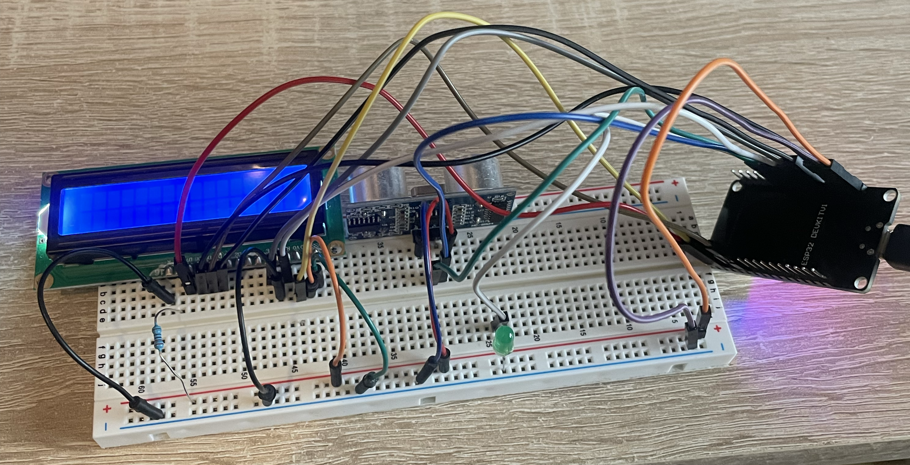

# ESP32 MQTT Remote Messenger

A connected physical notification box powered by an ESP32. The device connects to Wi-Fi, subscribes to an MQTT topic, and alerts the user to incoming text messages using an ambient LED pulse and an ultrasonic lid-detection trigger.

## Features

- **Real-Time Messaging:** Subscribes to an MQTT broker over Wi-Fi to receive and display remote payloads on a 16x2 LCD screen.
- **Ambient Alerting:** Visual breathing/pulse LED indicator signals unread messages.
- **Proximity/Lid Detection:** Ultrasonic distance sensor detects when the enclosure is opened, automatically surfacing the latest message and clearing the alert state.
- **Low-Latency Notification Loop:** Event-driven architecture handling Wi-Fi reconnects and message buffers.

## Hardware Components

- **MCU:** ESP32 Development Board
- **Display:** 16x2 I2C / Parallel LCD Display
- **Sensors:** HC-SR04 Ultrasonic Sensor
- **Indicators:** Diffused LED + current-limiting resistor
- **Peripherals:** Jumper wiring, breadboard/perfboard, 5V power supply

## Getting Started

### Prerequisites

- Arduino IDE (or PlatformIO / ESP-IDF)
- Required Arduino Libraries: `WiFi`, `PubSubClient`, `LiquidCrystal` (or `LiquidCrystal_I2C`)

### Installation & Flashing

1. Clone the repository:
   ```bash
   git clone [https://github.com/your-username/esp32-mqtt-remote-messenger.git](https://github.com/your-username/esp32-mqtt-remote-messenger.git)
   cd esp32-mqtt-remote-messenger
   ```

2. Configure network and broker credentials:
```bash
cp secrets.example.h secrets.h
```

Open `secrets.h` and populate your Wi-Fi SSID, password, and MQTT broker details (broker address, port, and topic).
3. Connect your ESP32 via USB and upload the sketch via Arduino IDE or PlatformIO.

## Wiring & Schematics

Refer to the breadboard layout below for pin mappings and connections:



## Demonstration

Video demonstration showcasing live message arrival, the pulse indicator, and ultrasonic display triggering:

https://github.com/user-attachments/assets/26d945f9-6a95-49b0-be4f-e9dcd2006c4b
